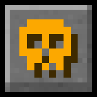

<div align="center">
    <h1>TotemShow</h1>
    <p>
        <a href="https://modrinth.com/project/totemshow">
            
        </a>
    </p>
    <p>A plugin, datapack and mod that detects when a player uses a Totem of Undying and broadcasts a message to all players.</p>
    <p>
        <a href="https://modrinth.com/project/totemshow"></a>
        <a href="https://modrinth.com/project/totemshow"></a>
    </p>
</div>

---


---

## Features
- Detects whenever any player uses a Totem of Undying.
- Broadcasts a customizable message using the `segtotems.message` translation key in resource packs for the datapack and mod versions, or by modifying the `config.yml` file for the plugin version.

---

## Customization (plugin)

The messages can be customized in the `config.yml` file of plugin.

```yml
messages:
  # Message sent when a player uses a Totem of Undying.
  #
  # Placeholders:
  # <player> - Player name.
  # <team-player> - Player name including team's prefixes and suffixes.
  # <item-name> - Displays the item's name.
  # <item-hover> - Displays the used item when the text is hovered.
  #
  # Permissions:
  # totemshow.send - Allows the player to broadcast the message to other players.
  # totemshow.receive - Allows the player to receive broadcast messages.
  resurrect: "<gold>☠ <reset><team-player> <gray>used a <yellow><item-hover>Totem of Undying</item-hover><gold>!"

  # Message displayed when using /totemshow reload, which reloads this config file.
  #
  # Permissions:
  # totemshow.admin - Allows the player to execute the command.
  reload: "<bold><#CF6704>[<gold>TotemShow<#CF6704>]</bold> <yellow>The configuration has been reloaded."

  # Message displayed when enabled via /totemshow on or /totemshow toggle.
  #
  # Permissions:
  # totemshow.admin - Allows the player to execute the command.
  enable: "<bold><#CF6704>[<gold>TotemShow<#CF6704>]</bold> <yellow>The plugin is now <green>enabled<yellow>."

  # Message displayed when disabled via /totemshow off or /totemshow toggle.
  #
  # Permissions:
  # totemshow.admin - Allows the player to execute the command.
  disable: "<bold><#CF6704>[<gold>TotemShow<#CF6704>]</bold> <yellow>The plugin is now <red>disabled<yellow>."

  # Messages displayed when using /totemshow.
  #
  # Permissions:
  # totemshow.admin - Allows the player to execute the command.
  help:
    - "<#CF6704><strikethrough>                       <reset><gold><bold> TotemShow </bold><#CF6704><strikethrough>                       "
    - "<gold>/totemshow on <#CF6704>- <yellow>Enables totem detection."
    - "<gold>/totemshow off <#CF6704>- <yellow>Disables totem detection."
    - "<gold>/totemshow toggle <#CF6704>- <yellow>Toggles totem detection."
    - "<gold>/totemshow reload <#CF6704>- <yellow>Reloads the plugin's configuration."
```

## Customization (datapack/mod)

You can customize the broadcast message by editing the `segtotems.message` key in your language file. The example below shows how the default message would look in an `en_us.json` file:

```json
{
    "segtotems.message": "§6☠ %s §7used a §eTotem of Undying§6!"
}
```

Modify this key in your own `en_us.json` (or equivalent) to change how the message appears in-game, this can be done inside a resource pack for better user experience.
